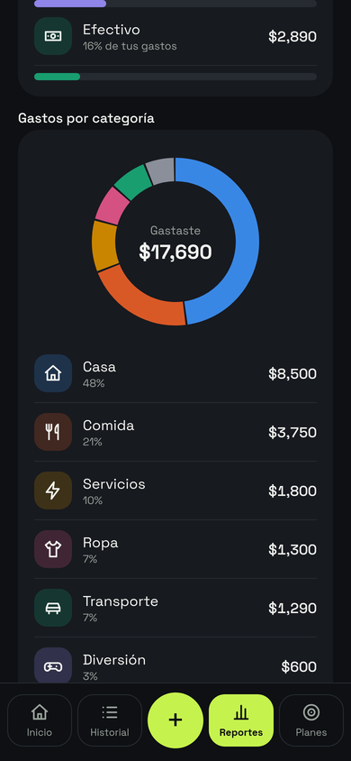
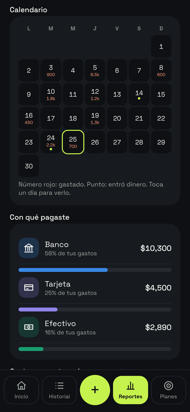
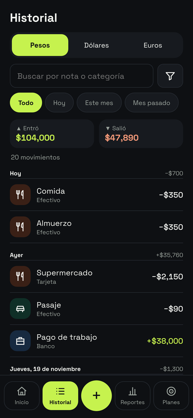
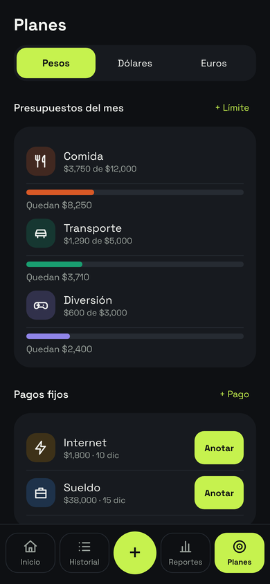

# Chelitos

App para llevar tu dinero en el teléfono: lo que entra, lo que sale y lo que quieres ahorrar. Funciona sin internet, sin cuentas ni anuncios, y **tus datos se quedan en tu teléfono**.

## Descargar

| Teléfono | Cómo |
|---|---|
| **Android** (8 o más nuevo) | **[Descargar el APK](https://github.com/crhb40-dev/chelitos/releases/latest/download/Chelitos.apk)** |
| **iPhone** (iOS 16.2 o más nuevo) | Abre **[la app web](https://crhb40-dev.github.io/chelitos/)** en Safari |

### Instalar en Android
1. Descarga el APK y ábrelo.
2. Si Android lo pide, permite instalar desde esa fuente. La app no viene de Play Store, así que el teléfono puede mostrar una advertencia.
3. En Samsung, si el **Bloqueador automático** lo impide, está en Ajustes › Seguridad y privacidad. Si lo desactivas, vuelve a activarlo después.

### Instalar en iPhone
1. Abre en **Safari** `https://crhb40-dev.github.io/chelitos/`.
2. Toca **Compartir** (si no lo ves, está en el botón `•••`).
3. Toca **Añadir a pantalla de inicio** y luego **Añadir**.
4. Ábrela desde su icono. La primera vez, con internet.

## Videos
- ▶️ **[Presentación de la app](https://crhb40-dev.github.io/chelitos/videos/Chelitos-presentacion.mp4)** (35 s)
- ▶️ **[Cómo instalarla en iPhone](https://crhb40-dev.github.io/chelitos/videos/Chelitos-instalar-en-iPhone.mp4)** (35 s). Las pantallas de Safari son ilustraciones y pueden variar según la versión de iOS.

## Capturas (con datos de ejemplo)

| Gráficos | Calendario | Historial | Planes |
|---|---|---|---|
|  |  |  |  |

## Qué hace
- **Anotar rápido:** escribe el monto y toca la categoría. Botones *Gasté* y *Me entró*, gastos frecuentes de un toque y *Deshacer*.
- **Pesos, dólares y euros**, cada uno por separado, y un total en pesos con la tasa que tú pongas.
- **Cuentas** (efectivo, banco, tarjeta) y transferencias entre ellas.
- **Reportes:** gráficos por categoría, comparación de 6 meses, calendario y resumen del mes.
- **Historial** con búsqueda y filtros.
- **Planes:** presupuestos, pagos fijos, metas de ahorro y deudas.
- **Seguridad:** PIN, huella (Android) o Face ID (iPhone).
- **A tu gusto:** tema claro u oscuro, colores, tamaño de letra y orden del inicio.
- **Tus datos:** copia de seguridad, recuperación en otro teléfono y exportación a Excel (CSV).
- **Notificaciones** de pagos fijos y recordatorio diario (solo Android).

## Ten en cuenta
- Los datos viven solo en el teléfono. **Guarda una copia** de vez en cuando (Ajustes › Tus datos): si desinstalas la app o pierdes el teléfono sin copia, se pierden.
- Las fotos de recibos no van en la copia.
- El bloqueo protege la pantalla, pero no cifra los datos.
- Android y iPhone no se sincronizan solos: se pasan los datos con *Guardar copia* y *Recuperar copia*.
- La versión para iPhone se ha probado en un navegador con el motor de Safari, no en todos los modelos de iPhone.

## Cómo está hecha
HTML, CSS y JavaScript sin frameworks. En Android se empaqueta con [Capacitor](https://capacitorjs.com/); en iPhone es una aplicación web instalable. Este repositorio contiene la app web; el APK está en [Releases](https://github.com/crhb40-dev/chelitos/releases).

Tipografía [Space Grotesk](fonts/LICENSE), bajo licencia SIL Open Font License.
